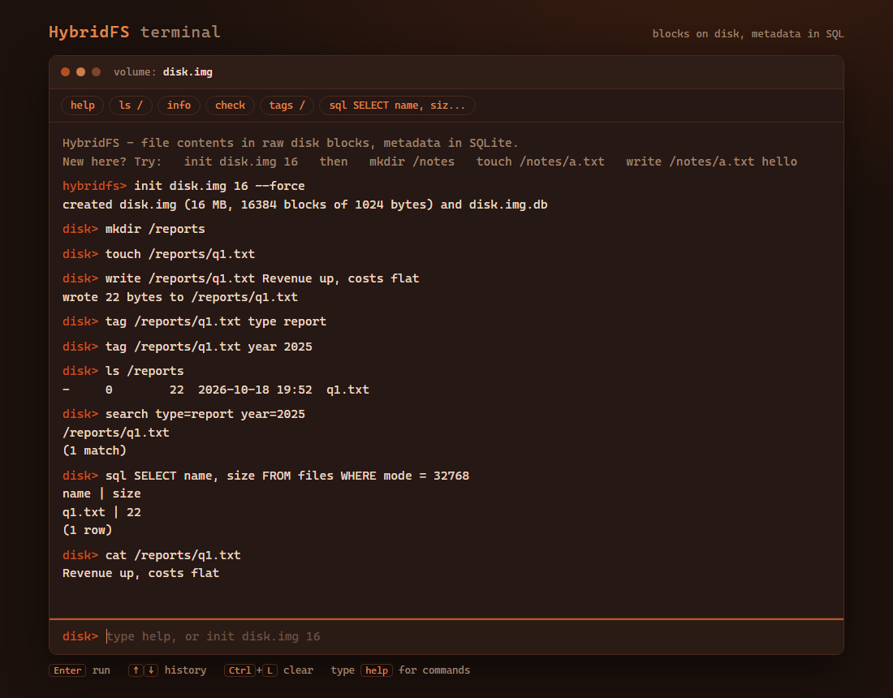

# HybridFS

**A small file system that keeps file contents in raw disk blocks and all metadata in a SQL database.**

Written in C with SQLite. Names, folders, owners, sizes, block pointers and tags live in a database next to the disk image,
and a write-ahead log keeps the two in step, so a crash in the middle of a write never leaves a half-old, half-new file.

It is a teaching project that models the idea behind systems like HDFS (a metadata service kept separate from data
storage). It is not a production file system.



```
 hybridfs> init disk.img 16
 hybridfs> mkdir /reports
 hybridfs> touch /reports/q1.txt
 hybridfs> write /reports/q1.txt Revenue up, costs flat\nsecond line
 hybridfs> tag /reports/q1.txt type report
 hybridfs> search type=report
 /reports/q1.txt
 (1 match)
 hybridfs> sql SELECT name, size FROM files WHERE mode = 32768
 hybridfs> rm -r /reports
```

## Features

- **Block storage:** 1 KiB blocks, a checksummed superblock and a multi-block allocation bitmap, for volumes of 1 to 2000 MB
- **Metadata in SQL:** a `files` table with constraints, a unique index and triggers that keep the tree valid
- **Crash safety:** copy-on-write updates, a write-ahead log, undo and redo recovery on open, and a `check` command in the style of fsck
- **Files and folders:** `mkdir`, `touch`, `write`, `cat`, `ls`, `stat`, `mv`, `chown`, and `rm`, `rm -r` and `rmdir` for deleting
- **Tags and search:** key/value tags stored in an indexed table, searched with `search key` or `search key=value ...`
- **SQL console:** `SELECT`, and `INSERT`, `UPDATE`, `DELETE` on metadata, with guard rails (see below)
- **Crash testing:** `crash_sim.exe` stops a write at a chosen step, like a power cut
- **Browser terminal:** the same shell in a browser tab, styled in rust and copper tones

## Quick start

You need `gcc` (MinGW-w64 on Windows). The Makefile expects it at `C:/mingw64/bin/gcc.exe`, so change `CC` at the top if yours is elsewhere.

```
mingw32-make              build hybridfs.exe, query_db.exe and crash_sim.exe
mingw32-make test         run all test suites (470 checks)
hybridfs.exe              interactive shell; type help
demo\run_demo.bat         load sample data and run example queries
ui\start_ui.bat           open the browser terminal (needs Python 3)
```

Non-interactive use:

```
hybridfs.exe disk.img -c "ls /" -c "info"       run commands and exit (exit code 1 if one failed)
hybridfs.exe < script.txt                        run a script of commands
query_db.exe -i disk.img "SELECT * FROM files"   run SQL without the shell
```

The last volume used is remembered in `.hybridfs_volume`, so later runs can leave out the image name.

## Commands

| command | what it does |
|---|---|
| `init <image> <size_mb> [--force]` | create a volume (1-2000 MB); refuses to overwrite unless `--force` |
| `use <image>` | open a volume (recovers it first if a crash left work half done) |
| `ls [path]`, `stat <path>` | list a folder; show everything stored about an entry |
| `mkdir <path>`, `touch <path>` | make a folder; make an empty file |
| `write <path> <text>` | replace a file's contents (up to 12288 bytes; `\n`, `\t`, `\\` are expanded) |
| `cat <path>` | print a file |
| `rm <path>` | delete a file |
| `rm -r <path>` | delete a folder and everything inside it |
| `rmdir <path>` | delete an empty folder |
| `mv <from> <to>` | rename or move (moves inside the target if it is a folder) |
| `chown <path> <id>` | change the owner id |
| `tag`, `untag`, `tags`, `search` | add, remove and list tags; find entries by tags |
| `sql <statement>` | run SQL against the metadata |
| `check [--fix]`, `recover` | consistency check (and repair); finish or undo interrupted work |
| `info` | sizes, free space and counts |

Paths always start from the root. `touch wow` and `touch /wow` are the same, and there is no `cd`.

## SQL console

```sql
SELECT name, size FROM files WHERE mode = 32768 ORDER BY size DESC;
INSERT INTO file_tags (file_id, tag_key, tag_value) VALUES (3, 'reviewer', 'asha');
UPDATE files SET name = 'design_v2.txt' WHERE name = 'design.txt';
DELETE FROM files WHERE name = 'logo.txt';      -- removes the row, its tags, and frees its disk blocks
```

Rules the database enforces, for the shell and the SQL console alike:

- Only `SELECT` and changes to `files` and `file_tags` are allowed. `DROP`, `CREATE`, `ALTER`, `PRAGMA`, `ATTACH`, transactions and anything touching the log are refused, and so is more than one statement at a time.
- `id`, `mode`, `size` and `block0..block11` cannot be edited from SQL, because the file system owns them. Use `write`.
- No two entries in a folder share a name, a parent must be a folder, a folder cannot move into itself, and the root cannot be changed or deleted.

More examples, including a table of statements the database refuses, are in [demo/QUERIES.md](demo/QUERIES.md).

## How it works

```
 hybridfs.exe / browser terminal / query_db.exe
                    |
        shell, tags, SQL console              (part 4)
                    |
   +----------------+-----------------+
   |                                  |
 tree, files table                file read/write, log, recovery
   (part 2)                              (part 3)
   |                                  |
   +----------------+-----------------+
                    |
        disk blocks + bitmap + ownership views   (part 1)
                    |
        disk.img            disk.img.db (SQLite)
```

**Image layout:** block 0 is a superblock (magic number, sizes, CRC-32). The next blocks are the allocation bitmap, one bit per block. The rest are data blocks. A file points at up to 12 blocks directly, so a file holds at most 12 KiB.

**Write protocol (copy-on-write):**

1. Pick fresh blocks. The file's current blocks are not touched.
2. Store the new block images in the `wal_log` table, marked uncommitted.
3. Write the blocks to the image and flush.
4. In one database transaction, point the file at the new blocks and mark the log rows committed.
5. Free the old blocks and drop older log rows.

A crash after step 2 or 3 leaves the old contents. A crash after step 4 leaves the new contents. There is no state in between.

**Recovery** runs whenever a volume is opened:
1. Undo: discard unfinished log rows.
2. Rebuild the bitmap from the metadata, which is the source of truth.
3. Redo: rewrite any committed block that is missing or different on the image.

Running recovery twice changes nothing the second time.

**Try it:**

```
crash_sim.exe disk.img /notes/a.txt after_data      exits with code 86, like a power cut
hybridfs.exe disk.img -c "check" -c "cat /notes/a.txt"
```

The steps are `after_log`, `after_data` and `after_commit`. The first two leave the old contents. The third leaves the new ones.

## Project layout

The project is split into four parts. Each has an operating-systems half and a database half, its own README, and its own tests.

| part | folder | OS half | DBMS half |
|---|---|---|---|
| 1 | `part1_storage` | block device, superblock, allocation bitmap | ownership views, bitmap rebuild, space report |
| 2 | `part2_namespace` | path resolution, create, list, rename, delete | `files` table: constraints, unique names, triggers |
| 3 | `part3_recovery` | copy-on-write read/write, crash points, consistency checker, `crash_sim` | `wal_log` table, transactions, recovery, `query_db` |
| 4 | `part4_interface` | shell, `hybridfs.exe` | `file_tags` table, guarded SQL console |

`common/` holds the shared helpers and the `Volume` type that ties an image and its database together. `ui/` is the browser terminal, `demo/` has sample data and queries, and `tests/` has the test programs.

Who wrote which file, and the commit plan, are in [COMMIT_PLAN.md](COMMIT_PLAN.md).

## Testing

```
mingw32-make test       all suites
mingw32-make part1      one part (part1 to part4)
mingw32-make whole      the finished programs, run the way a user runs them
```

The suites cover the disk and allocator, every database rule, path handling, deletes, the SQL guard rails, recovery from each crash point (by running `crash_sim.exe` and reopening), and the consistency checker on deliberately damaged volumes. The code builds with `-Wall -Wextra -Werror`.

## Browser terminal

```
ui\start_ui.bat
```

Opens `http://127.0.0.1:8765/`. Each command is passed to the real `hybridfs.exe`, one at a time, and the server listens on your own computer only. Volumes made there are kept in `ui\volumes`.

## Limitations

- **One user at a time.** Two programs using the same volume are not coordinated. They can hand out the same block twice, and opening a volume runs recovery, which assumes nobody else is mid-write. The browser terminal serialises its own commands but does not lock the volume against other programs.
- Files are at most 12 KiB (direct block pointers only) and volumes at most 2000 MB.
- `owner_id` is recorded but permissions are not enforced.
- No encryption, compression, caching or replication.

## Ideas for future work

- An exclusive volume lock taken when a volume is opened, then shared locks so read-only tools can run alongside a writer
- Keeping the bitmap in the database so allocation is decided by a transaction
- Indirect blocks for larger files
- Permission checks using the owner id
- Replicating the metadata database

## Credits

Built by a team of four, as a project on the OS/DBMS split: Manoj, Vignesh, Satvik and Moulik.

SQLite is public domain and is included in `sqlite/`. 
